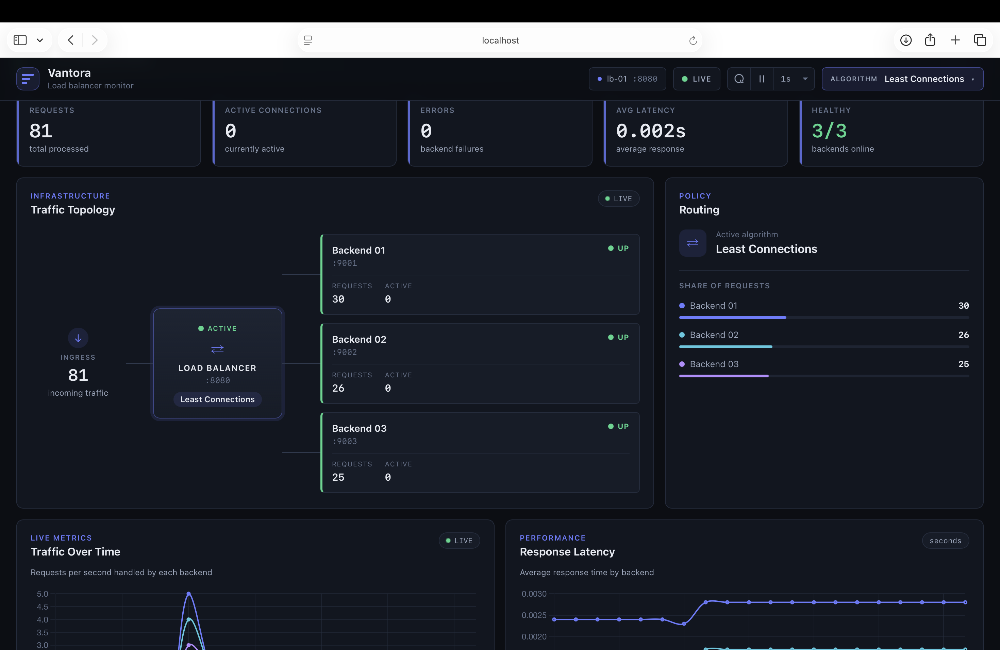

# Vantora — Dynamic Load Balancer

A Python-based HTTP reverse proxy that distributes incoming requests across multiple backend servers using Round Robin, Weighted Round Robin, and Least Connections. It includes health monitoring, circuit breakers, automatic failover, request statistics, a live dashboard, Docker Compose support, automated tests, load-testing benchmarks, and Wireshark traffic evidence.

## Contents

- [Features](#features)
- [Architecture](#architecture)
- [Ports and Services](#ports-and-services)
- [Prerequisites](#prerequisites)
- [Quick Start with Docker](#quick-start-with-docker)
- [Run Without Docker](#run-without-docker)
- [Using the Load Balancer](#using-the-load-balancer)
- [API Endpoints](#api-endpoints)
- [How It Works](#how-it-works)
- [Configuration](#configuration)
- [Dashboard](#dashboard)
- [Tests](#tests)
- [Load Testing](#load-testing)
- [Wireshark Evidence](#wireshark-evidence)
- [Project Structure](#project-structure)
- [Known Limitations](#known-limitations)
- [Troubleshooting](#troubleshooting)
- [Project Team and Academic Details](#project-team-and-academic-details)

## Features

- **Multiple routing algorithms:** Round Robin, Weighted Round Robin, and Least Connections.
- **Health monitoring:** Periodically checks backend availability and tracks consecutive failures and successes.
- **Automatic failover:** Avoids unavailable backends and retries eligible requests.
- **Circuit breaker:** Uses CLOSED, OPEN, and HALF_OPEN states to prevent repeated requests to failing backends.
- **Request statistics:** Tracks request counts, errors, backend distribution, and health status.
- **Live dashboard:** Displays backend health, routing configuration, request statistics, and distribution charts.
- **Docker Compose:** Runs the load balancer, dashboard, and three backend services.
- **Automated tests:** Includes unit and integration-oriented tests for routing, health monitoring, failover, and reporting.
- **Load-testing benchmarks:** Compares routing algorithms using Locust and records results in CSV files and graphs.
- **Wireshark evidence:** Includes packet captures for routing distribution, concurrent requests, backend failure, and recovery.

## Architecture

The project contains five services.

```text
                    Clients / Browser
                           |
                           v
                  +------------------+
                  |  Load Balancer   |
                  |    Port 8080     |
                  +------------------+
                    /      |      \
                   /       |       \
                  v        v        v
             Backend 1  Backend 2  Backend 3
              :9001      :9002      :9003

                  +------------------+
                  |    Dashboard     |
                  |    Port 5050     |
                  +------------------+
```

The dashboard communicates with the load balancer to retrieve statistics and change the routing algorithm. Client requests are forwarded by the load balancer to a selected healthy backend.

The load balancer adds an `X-Served-By` response header to identify the backend that served a request.

## Ports and Services

| Service | Port | Purpose |
|---|---:|---|
| Load balancer | 8080 | Receives and routes client requests |
| Dashboard | 5050 | Displays health and traffic statistics |
| Backend 1 | 9001 | First backend server |
| Backend 2 | 9002 | Second backend server |
| Backend 3 | 9003 | Third backend server |

## Prerequisites

For Docker-based execution:

- Docker Desktop or Docker Engine
- Docker Compose

For running locally without Docker:

- Python 3.9 or later
- The Python dependencies listed in the project requirements files
- Available ports 5050, 8080, 9001, 9002, and 9003

The local test suite was verified using Python 3.9.6. The Docker load-balancer container was verified using Python 3.11.17.

## Quick Start with Docker

### 1. Clone the repository

```bash
git clone https://github.com/sharmanayna025-crypto/Vantora.git
cd Vantora
```

### 2. Start the services

```bash
docker compose up --build -d
```

### 3. Check service status

```bash
docker compose ps
```

All five services should become healthy.

### 4. Open the dashboard

Open the following URL in your browser:

http://localhost:5050

### 5. Send a request through the load balancer

```bash
curl -i http://localhost:8080/
```

The response should identify the backend that handled the request.

### 6. View statistics

```bash
curl http://localhost:8080/stats
```

### 7. Stop the services

```bash
docker compose down
```

To stop the services and remove the containers, use `docker compose down`. Persistent files and images are not necessarily removed by this command.

## Run Without Docker

Running manually is an alternative to the Docker setup. **Do not run the manual servers while Docker is already publishing the same ports.**

### 1. Stop the Docker stack

```bash
docker compose down
```

Ensure ports 5050, 8080, and 9001–9003 are available.

### 2. Create and activate a virtual environment

On macOS or Linux:

```bash
python3 -m venv .venv
source .venv/bin/activate
```

### 3. Install the dependencies

Install the dependencies specified by the repository's requirements files. For example, if a root `requirements.txt` exists:

```bash
pip install -r requirements.txt
```

If the project has separate requirements files for the backend, load balancer, or dashboard, install the dependencies required by each component.

### 4. Start the backend servers

Open separate terminal windows from the project root and activate the virtual environment in each terminal.

Terminal 1:

```bash
python backend/app.py 9001
```

Terminal 2:

```bash
python backend/app.py 9002
```

Terminal 3:

```bash
python backend/app.py 9003
```

### 5. Start the load balancer

In another terminal:

```bash
python lb/balancer.py
```

### 6. Start the dashboard

In another terminal:

```bash
python dashboard/app.py
```

Open http://localhost:5050 to view the dashboard.

**Note:** These commands assume the entry-point files and argument formats match the current repository. If you encounter a missing-file or missing-dependency error, check the corresponding component's instructions and requirements.

## Using the Load Balancer

Once the services are running, send requests to port 8080:

```bash
curl -i http://localhost:8080/
```

Send multiple requests to observe the selected backend:

```bash
for i in $(seq 1 10); do
  curl -s -i http://localhost:8080/ | grep -i "X-Served-By"
done
```

The exact distribution depends on the selected algorithm, backend health, and whether requests overlap in time.

### Changing the routing algorithm

Use the dashboard to select a routing algorithm. The dashboard sends the change to the load balancer through the algorithm configuration endpoint.

The available algorithms are:

- Round Robin
- Weighted Round Robin
- Least Connections

## API Endpoints

| Endpoint | Method | Purpose |
|---|---|---|
| `/` | GET | Sends a request through the load balancer |
| `/stats` | GET | Returns load-balancer statistics |
| `/algorithm` | POST | Changes the active routing algorithm |

The root endpoint and statistics endpoint are intended for direct testing. Other paths and HTTP methods depend on the implemented proxy and route handling.

Example:

```bash
curl -i http://localhost:8080/
```

Retrieve statistics:

```bash
curl -s http://localhost:8080/stats
```

The `/algorithm` endpoint is used by the dashboard to change the routing strategy. Consult the implementation for the accepted request-body format.

## How It Works

### 1. Round Robin

Round Robin selects healthy backends sequentially and cycles through the available servers.

For three healthy backends, requests follow a sequence similar to:

```text
Request 1  -> Backend 1
Request 2  -> Backend 2
Request 3  -> Backend 3
Request 4  -> Backend 1
```

With 30 sequential requests and all backends healthy, the expected distribution is 10 requests per backend.

### 2. Weighted Round Robin

Weighted Round Robin assigns a different weight to each backend.

The configured weights are:

| Backend | Port | Weight |
|---|---:|---:|
| Backend 1 | 9001 | 3 |
| Backend 2 | 9002 | 2 |
| Backend 3 | 9003 | 1 |

The expected allocation ratio is 3:2:1.

For 30 requests, the expected distribution is:

- Backend 1: 15 requests
- Backend 2: 10 requests
- Backend 3: 5 requests

Actual results can vary when backends become unhealthy or the configuration changes.

### 3. Least Connections

Least Connections selects the eligible backend with the fewest active connections.

This algorithm is most meaningful when requests overlap in time or remain active for different durations. When requests are sent sequentially and each completes before the next begins, all backends may have zero active connections at selection time. In that situation, tie-breaking can cause traffic to favor the first backend.

### 4. Health Monitoring

The load balancer periodically checks the health of each backend.

The configured behavior is:

- Health-check interval: 2 seconds
- Health-check timeout: 2 seconds
- Three consecutive failures: backend marked DOWN
- Two consecutive successes: backend marked UP

Unavailable backends are excluded from normal routing until they recover according to the health-check logic.

### 5. Circuit Breaker

The circuit breaker protects the system from repeatedly sending requests to a failing backend.

It uses three states:

| State | Behavior |
|---|---|
| CLOSED | Requests can be sent normally |
| OPEN | Requests to the failing backend are blocked temporarily |
| HALF_OPEN | A limited probe checks whether the backend has recovered |

The configured circuit-breaker behavior opens the circuit after three consecutive failed client requests and uses a 10-second cooldown before allowing a half-open probe.

### 6. Retry and Failover

When a backend fails, the load balancer can retry eligible requests against another healthy backend.

Retries must be handled carefully because repeating a request can duplicate its effects. The implementation limits retry behavior to eligible requests and does not assume that every failure is safe to retry.

The load balancer also applies connection, read, and overall request deadlines.

## Configuration

The following environment variables are supported by the relevant components:

| Variable | Purpose |
|---|---|
| `VANTORA_BACKEND_HOSTS` | Configures backend hosts |
| `VANTORA_CONNECT_TIMEOUT` | Configures connection timeout |
| `VANTORA_READ_TIMEOUT` | Configures read timeout |
| `VANTORA_REQUEST_DEADLINE` | Configures the overall request deadline |
| `LB_URL` | Configures the load-balancer URL used by the dashboard |
| `LB_TIMEOUT` | Configures the dashboard's load-balancer request timeout |
| `DASHBOARD_HOST` | Configures the dashboard bind address |
| `DASHBOARD_PORT` | Configures the dashboard port |
| `DASHBOARD_DEBUG` | Configures the dashboard debug setting |

Default timeout values:

- Connection timeout: 1 second
- Read timeout: 10 seconds
- Overall request deadline: 20 seconds

Use environment variables to override defaults where supported. Refer to the relevant implementation files for accepted formats and fallback behavior.

## Dashboard

### Dashboard Overview

The Vantora dashboard provides a real-time view of backend health, request distribution, load-balancing algorithms, and traffic statistics.


The dashboard is available at:

http://localhost:5050

It provides a visual interface for monitoring the load balancer.

The dashboard includes:

- Active routing algorithm
- Backend health information
- Request and error statistics
- Backend request distribution
- Controls for changing the routing algorithm
- Traffic-distribution charts

The dashboard communicates with the load balancer for statistics and configuration changes. Chart rendering uses Chart.js from a CDN, so chart assets may require an internet connection.

## Tests

The project contains automated tests covering the implemented routing, backend health, circuit-breaker, retry/failover, and reporting behavior.

Run the full test suite from the project root:

```bash
.venv/bin/python -m unittest discover -s tests -v
```

Run the benchmark-report consistency tests separately:

```bash
.venv/bin/python -m unittest tests.test_benchmark_report -v
```

### Latest verified test run

**Verification date: 14 October 2026**

- Full suite: 111 tests passed
- Failures: 0
- Errors: 0
- Local test environment: Python 3.9.6
- Docker load-balancer environment: Python 3.11.17
- Docker Compose services: five services reported healthy during verification
- Benchmark-report consistency tests: three tests passed

These results describe the environments actually tested. They do not establish compatibility with every Python version or every operating system.

See [`docs/architecture-and-testing.md`](docs/architecture-and-testing.md) for additional architecture and test documentation.

## Load Testing

The project includes Locust-based load-testing experiments for comparing the routing algorithms.

The recorded experiments use:

- 20 simulated users
- 60 seconds per algorithm
- Round Robin
- Weighted Round Robin
- Least Connections

The results are stored in `docs/load-testing/`.

Important files include:

- `docs/load-testing/benchmark-comparison.md`
- The recorded benchmark CSV files
- The generated performance graphs

The benchmark-report consistency tests verify that the report, graph files, and raw CSV results agree with one another.

Load-testing results depend on the machine, request workload, backend response times, and execution environment. They should be interpreted as measurements of the recorded test setup rather than universal performance guarantees.

## Wireshark Evidence

The repository contains packet captures and supporting analysis for demonstrating the behavior of the load balancer.

Evidence is stored in `docs/wireshark/`.

| Evidence file | Purpose |
|---|---|
| `round-robin-distribution.pcapng` | Round Robin traffic distribution |
| `weighted-distribution.pcapng` | Weighted Round Robin traffic distribution |
| `least-connections-concurrent.pcapng` | Concurrent Least Connections traffic |
| `failover-backend-9002-down.pcapng` | Traffic while backend 9002 is stopped |
| `recovery-backend-9002.pcapng` | Traffic after backend 9002 recovers |
| `load-balancer-to-backends.pcap` | Load-balancer-to-backend traffic |
| `backend-traffic-evidence.png` | Screenshot supporting the packet-capture evidence |

Additional files include:

- `docs/wireshark/README.md`
- `docs/wireshark/analyze_capture.py`
- `docs/wireshark/generate_traffic.py`

The expected results for the recorded scenarios are:

- **Round Robin:** approximately equal distribution across three healthy backends.
- **Weighted Round Robin:** traffic following the configured 3:2:1 weight ratio.
- **Least Connections:** distribution influenced by concurrent active connections and tie-breaking.
- **Failover:** requests avoid backend 9002 while it is unavailable.
- **Recovery:** backend 9002 becomes eligible again after successful health checks.

The captures were generated in a local non-Docker setup because Docker Desktop's internal network traffic is not necessarily visible directly on the host's loopback interface.

Wireshark filters can help isolate traffic to the load balancer and the backend ports. For example:

```text
tcp.port == 8080
```

For a particular backend, filter on its port, such as:

```text
tcp.port == 9002
```

Use the included README and analysis script for capture-specific instructions.

## Project Structure

```text
Vantora/
├── backend/
│   └── app.py
├── dashboard/
│   └── app.py
├── lb/
│   ├── balancer.py
│   └── circuit_breaker.py
├── tests/
├── docs/
│   ├── screenshots/
│   │   ├── graphs.png
│   │   ├── health.png
│   │   └── traffic topology.png
│   ├── wireshark/
│   │   ├── README.md
│   │   ├── analyze_capture.py
│   │   ├── generate_traffic.py
│   │   ├── backend-traffic-evidence.png
│   │   ├── round-robin-distribution.pcapng
│   │   ├── weighted-distribution.pcapng
│   │   ├── least-connections-concurrent.pcapng
│   │   ├── failover-backend-9002-down.pcapng
│   │   └── recovery-backend-9002.pcapng
│   ├── architecture-and-testing.md
│   ├── submission-checklist.md
│   └── load-testing/
│       └── benchmark-comparison.md
├── docker-compose.yml
├── README.md
└── client-to-load-balancer.pcapng
```

The tree highlights the main project components and evidence files. Additional test files, configuration files, benchmark CSVs, and generated graphs may exist in their respective directories.

## Known Limitations

1. **HTTP scope:** The project is an educational HTTP reverse proxy rather than a production-grade general-purpose proxy.
2. **Request methods:** The implemented proxy supports the routes and methods defined in the code. The `/algorithm` endpoint is used for configuration; arbitrary HTTP method forwarding should not be assumed.
3. **No authentication:** The dashboard and configuration endpoints do not provide production-grade authentication or authorization.
4. **Single load balancer:** The application does not provide a highly available cluster of load balancers.
5. **In-memory statistics:** Statistics may reset when the process restarts and are not a persistent monitoring database.
6. **Development server:** The Flask-based services are intended for a controlled academic environment, not direct production deployment.
7. **Benchmark scope:** Recorded load-test results represent the documented test conditions and are not a universal performance guarantee.
8. **Retry safety:** Retrying requests can be unsafe when an operation has already produced side effects. Retry behavior must account for request semantics.
9. **Dashboard dependencies:** Chart rendering depends on loading Chart.js from a CDN.
10. **Network visibility:** Host-side packet capture may not expose all traffic inside Docker's virtual network.
11. **Python compatibility:** The local test suite was verified with Python 3.9.6, and the Docker load balancer was verified with Python 3.11.17. Other Python versions have not been exhaustively tested.

## Troubleshooting

### Port already in use

If a server reports `Address already in use`, another process is listening on the required port.

Check the port on macOS:

```bash
lsof -nP -iTCP:9001 -sTCP:LISTEN
```

Replace `9001` with the affected port.

If the Docker stack is running, stop it before starting the services manually:

```bash
docker compose down
```

Do not terminate processes until you have identified which service owns the port.

### A backend is marked DOWN

Check the backend containers:

```bash
docker compose ps
```

Inspect the relevant backend logs:

```bash
docker compose logs backend-9002
```

Replace `backend-9002` with the affected service. Allow the health-check mechanism time to register successful recovery after the backend is restored.

### The dashboard cannot retrieve statistics

Check that the load balancer is running and that the configured `LB_URL` points to the correct address for the current execution mode.

For Docker Compose, the dashboard may need to communicate with the load balancer using its Compose service name rather than `localhost`, depending on the configured environment.

### Tests fail because of missing dependencies

Activate the project virtual environment and install the required packages. Check the relevant requirements file before installing dependencies.

```bash
source .venv/bin/activate
```

Then run the test suite again:

```bash
python -m unittest discover -s tests -v
```

### Docker services are not healthy

Inspect the service status and logs:

```bash
docker compose ps
docker compose logs
```

Resolve the reported issue before running load tests or collecting new packet captures.

## Project Team and Academic Details

**Project:** Vantora — Dynamic Load Balancer

**Institution:** MIT World Peace University (MIT-WPU)

**Course:** Computer Networks Laboratory (CSE20110)

**Academic Year:** 2026–2027

**Project Team:** 


| Sr. No. | Team Member Name | PRN Number |
|---:|---|---|
| 1 | Nayna Sharma | 1262241524 |
| 2 | Harshad Pardhi | 1262241534 |
| 3 | Aaryan Kumbhare | 1262241729 |
| 4 | Anurag Harapanahalli | 1262241775 |